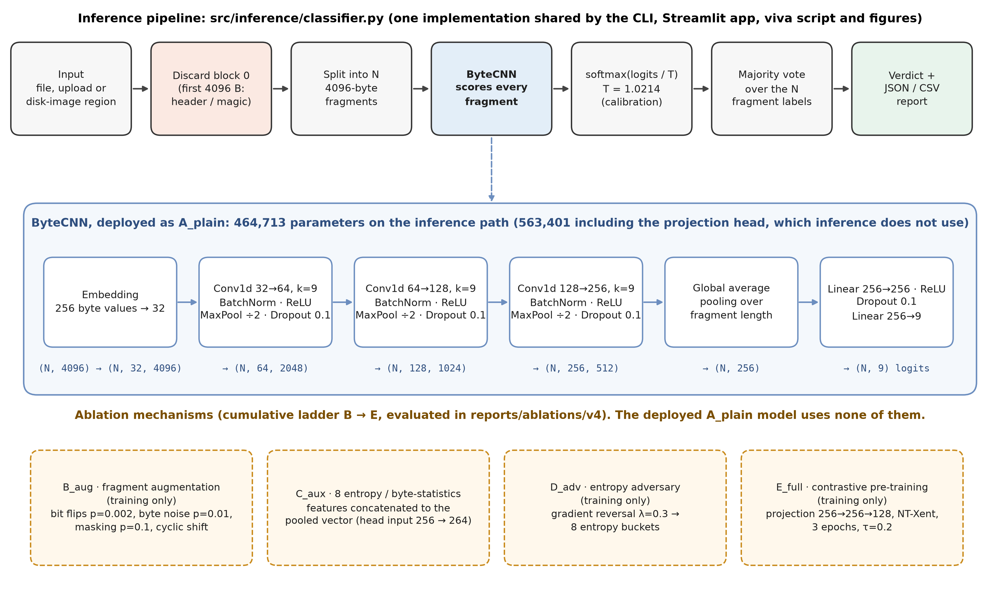

# FragGen V4

**File-fragment type classification for digital forensics.** Given one 4096-byte
block from the *middle* of an unknown file (no name, no header, no filesystem),
FragGen predicts which of nine types it came from, explains the prediction
fragment by fragment, and votes on a file-level verdict.

`txt · csv · html · xml · pdf · jpg · png · gif · zip`

📄 **[Download the final report and project summary (PDF)](https://github.com/surya-kaiser/Fraggen/releases/tag/v4.0.0)**



---

## Results at a glance

| question | result | source |
|---|---|---|
| Unseen **files** from the training sources (Dataset V4, test split) | **0.8938 ± 0.0036** accuracy · **0.8976 ± 0.0041** macro-F1 (3 seeds) | `reports/ablations/v4/` |
| Unseen **corpus** (train FFT-75 → test GovDocs1, 4096 B) | **0.6812 ± 0.0141** accuracy (2 seeds) | `reports/ablations/cross_corpus_fft75_govdocs1/` |

> These two numbers answer **different questions** and are never compared directly.
> V4's test files come from the same corpora as its training files; the cross-corpus
> study tests on a different corpus. See `docs/thesis/RESULTS_AND_DISCUSSION.md` §8.

**Ablation (Dataset V4, 3 seeds each):** none of the four mechanisms improves test
accuracy over the plain CNN — the largest change, D_adv's −0.034, is not
statistically distinguishable from seed noise (Holm p = 0.31), matching the earlier
cross-corpus finding on a different dataset. Full statistics, per-seed detail and
McNemar tests: `reports/ablations/v4/ABLATION_RESULTS.md`.

| config | test accuracy | Δ vs A_plain | Holm p |
|---|---|---|---|
| A_plain | 0.8938 ± 0.0036 | — | — |
| B_aug | 0.8958 ± 0.0032 | +0.0019 | 1.000 |
| C_aux | 0.8938 ± 0.0086 | −0.0001 | 1.000 |
| D_adv | 0.8603 ± 0.0152 | −0.0336 | 0.313 |
| E_full | 0.8760 ± 0.0159 | −0.0179 | 0.759 |

**Main error, explained:** PDF fragments are often called ZIP or JPG. Parsing the PDFs'
own stream objects shows why. ZIP calls come from FlateDecode (DEFLATE) streams and JPG
calls from embedded JPEGs, while all 122 test fragments consisting of PDF object syntax
are recognised as PDF (`reports/figures/fig7_pdf_container_analysis.png`).

---

## Quick start

```bash
pip install -r requirements.txt
python -m unittest discover -s tests -t .          # repository, inference, report and checkpoint tests

python demo/cli/demo.py sample.pdf                 # classify a file (bare names resolve to demo/samples/)
python demo/cli/viva_demo.py                       # narrated demonstration
streamlit run demo/streamlit/app.py                # interactive web app (run from the repo root)
```

A GPU is optional; set `FRAGGEN_DEVICE=cpu` to force CPU. The demo needs only
`checkpoints/` and `demo/samples/`, not the raw corpora.

---

## Repository layout

```
FragGen/
├── README.md · LICENSE · requirements.txt
├── src/
│   ├── models/          ByteCNN, NT-Xent loss, feature baseline, checkpoint loading
│   ├── training/        train.py (python -m src.training.train), eval.py
│   ├── inference/       FragGenClassifier: bytes → fragments → predictions → verdict
│   ├── preprocessing/   FragmentSet, corpus loaders, augmentation, entropy features
│   ├── explainability/  JSON/CSV reports, verdict notes, PDF stream mapping
│   └── utils/           config, metrics, calibration, result readers, plot style
├── configs/             default.yaml, real.yaml
├── data/
│   ├── raw/             corpora (git-ignored, see data/raw/README.md)
│   ├── processed_v4/    train / val / test .npz
│   └── metadata/        V4 split manifest, per-fragment provenance, build report
├── checkpoints/
│   ├── v4/              <config>_s<seed>.pt for the ablation ladder
│   └── calibration/     temperature-scaling files
├── reports/
│   ├── figures/         8 publication figures (+ cross_corpus/)
│   ├── tables/          CSV/Markdown result tables
│   ├── ablations/       v4/ and cross_corpus_fft75_govdocs1/ result files
│   ├── confusion_matrices/
│   └── datasets/        dataset audits and the V4 build report
├── docs/
│   ├── thesis/          RESULTS_AND_DISCUSSION (.md/.pdf), FINDINGS, REVIEW1
│   ├── viva/            DEMO_GUIDE, VIVA_SCRIPT, EXAMINER_QA
│   └── architecture/    ARCHITECTURE
├── demo/
│   ├── cli/             demo.py, viva_demo.py
│   ├── streamlit/       app.py
│   ├── samples/         9 correctly classified samples + 2 documented tricky cases
│   └── outputs/         generated reports (git-ignored)
├── scripts/             dataset build, ablation driver and analysis, calibration, figures, PDF rendering
├── tests/               unittest suite
└── archive/             superseded datasets, checkpoints and code, byte-identical (see archive/README.md)
```

---

## Reproducing the results

```bash
# 1. Dataset V4 (needs data/raw/, see docs/DATASETS.md)
python scripts/extract_wiki_pages.py --dump data/raw/downloads/simplewiki-latest-pages-articles.xml.bz2 \
    --out data/raw/wiki_pages --min-size 8192
python scripts/build_processed_v4.py

# 2. Ablation ladder: 5 configs x 3 seeds, 6 epochs, 4096 B (the driver's defaults)
python scripts/run_ablations.py

# 3. Statistics, tables and confusion matrices
python scripts/analyze_ablations.py

# 4. Calibration for the deployed checkpoint
python scripts/calibrate.py --model checkpoints/v4/A_plain_s1337.pt \
    --val data/processed_v4/val.npz --in-test data/processed_v4/val.npz --cross data/processed_v4/test.npz

# 5. Figures and PDF reports
python scripts/make_publication_figures.py
python scripts/render_pdf.py docs/thesis/RESULTS_AND_DISCUSSION.md
```

The driver reuses any run whose report already exists, so an interrupted run resumes.
The cross-corpus study's commands are in `docs/DATASETS.md` §4 and `docs/thesis/FINDINGS.md`.

---

## Documentation

| document | contents |
|---|---|
| [`docs/thesis/RESULTS_AND_DISCUSSION.md`](docs/thesis/RESULTS_AND_DISCUSSION.md) (+ PDF) | final research report |
| [`docs/architecture/ARCHITECTURE.md`](docs/architecture/ARCHITECTURE.md) | system design, data pipeline, model, invariants |
| [`docs/viva/DEMO_GUIDE.md`](docs/viva/DEMO_GUIDE.md) | how to run and present the demo |
| [`docs/viva/VIVA_SCRIPT.md`](docs/viva/VIVA_SCRIPT.md) | timed presentation script |
| [`docs/viva/EXAMINER_QA.md`](docs/viva/EXAMINER_QA.md) | 15 examiner questions with sourced answers |
| [`docs/thesis/FINDINGS.md`](docs/thesis/FINDINGS.md) | cross-corpus study findings |
| [`reports/ablations/v4/ABLATION_RESULTS.md`](reports/ablations/v4/ABLATION_RESULTS.md) | V4 ablation statistics |
| [`reports/figures/FIGURES.md`](reports/figures/FIGURES.md) | figure captions and data sources |
| [`docs/DATASETS.md`](docs/DATASETS.md) | corpora, download and preparation |
| [`docs/REPOSITORY_AUDIT.md`](docs/REPOSITORY_AUDIT.md), [`docs/REMOVED_FILES.md`](docs/REMOVED_FILES.md) | cleanup audit and the record of every moved or removed file |
| [`docs/FINAL_PROJECT_SUMMARY.md`](docs/FINAL_PROJECT_SUMMARY.md) (+ PDF) | final summary and checklists |

---

## Data and licence

The code and documentation are MIT-licensed (`LICENSE`). **The datasets are not:**
GovDocs1, DFRWS, FFT-75, RICO, TGIF, Wikipedia (CC BY-SA) and the files collected from
GitHub repositories keep their original terms, and they are git-ignored. Dataset V4's
npz files (`train.npz` is 132 MiB) exceed GitHub's file-size limit; distribute them with
Git LFS or separately. The manifests in `data/metadata/` are enough to rebuild them from
the raw corpora.
