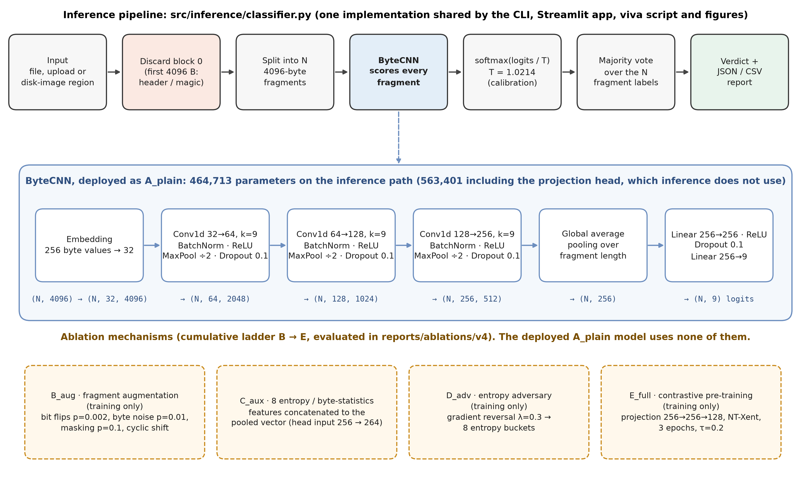
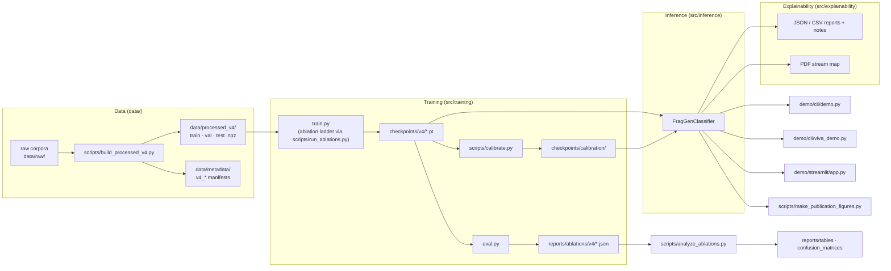

# FragGen V4 — System Architecture

*(Vector version: `reports/figures/fig8_pipeline_architecture.svg`. Layer sizes,
parameter counts and the temperature in the figure are read from the checkpoint
and calibration file, not typed by hand.)*

---

## 1. System overview

**Invariants the design enforces**

1. **The header block is never scored.** The dataset builder samples fragments from
   offset 4096 onward, and `FragGenClassifier.fragment_bytes` discards block 0. An input
   with no complete block after it yields *no* prediction, rather than falling back to the
   header.
2. **There is one inference implementation.** The CLI, Streamlit, viva script and figure
   generator all call `src/inference/classifier.py`, and none of them re-implements a step.
3. **Displayed numbers come from files.** `src/utils/results.py` reads headline metrics
   from the evaluation reports, and the figures read theirs from reports, logs, metadata
   or checkpoints.
4. **Calibration cannot change a prediction.** Temperature scaling divides the logits by a
   positive scalar before the softmax, so the argmax is unchanged.
5. **Archived material is frozen.** `archive/` is kept for provenance only; active code
   never imports it.

## 2. Package map

| package | modules | responsibility |
|---|---|---|
| `src.models` | `cnn.py`, `contrastive.py`, `baseline.py`, `checkpoint.py` | ByteCNN (unchanged from training), NT-Xent loss, logistic-regression feature baseline, checkpoint loading |
| `src.preprocessing` | `fragments.py`, `augment.py`, `entropy.py`, `fft75.py`, `govdocs.py`, `dfrws.py`, `synthetic.py` | `FragmentSet` container, augmentation, entropy features, corpus loaders |
| `src.training` | `train.py`, `eval.py` | training CLI (`python -m src.training.train`), evaluation CLI (`python -m src.training.eval`) |
| `src.inference` | `classifier.py` | `FragGenClassifier`, `FileVerdict`, `FragmentResult` |
| `src.explainability` | `report.py`, `container_analysis.py` | JSON/CSV export, verdict notes, PDF stream parsing |
| `src.utils` | `config.py`, `metrics.py`, `calibration.py`, `results.py`, `plotting.py` | YAML config, metrics, temperature scaling/ECE, headline-number reader, shared figure style |

The `src` package came from the former `fraggen` package by moving modules and
rewriting import paths only. Equivalence was verified on CPU: the old and new packages
produce bit-identical logits and identical `evaluate_corpus` output on V4 test
fragments, and a one-epoch training run with every mechanism enabled gives
bit-identical weights.

## 3. Data layer — Dataset V4

Built by `scripts/build_processed_v4.py` (see `reports/datasets/DATASET_V4_AND_CLEANUP_2026-09-14.md`).

| rule | value |
|---|---|
| classes | txt, csv, html, xml, pdf, jpg, png, gif, zip |
| fragment | 4096 bytes, non-overlapping, sampled from offset 4096 onward (header excluded) |
| minimum source file | 8,192 B |
| split | 70 / 15 / 15 at the **file** level, per class, seed 42, disjointness asserted |
| balance | per-class cap of 10,000 fragments across splits; at most 20 fragments per file |
| leakage guard | fragments starting with the class's magic signature are dropped |
| DFRWS 2007 | test split only (pdf/jpg/zip), added on top of the cap |
| result | 61,940 train · 13,111 val · 13,754 test fragments |

Provenance for every fragment (file id, offset, source) is in
`data/metadata/v4_fragment_metadata.csv`, and the npz files store the same file ids
and offsets. Every GovDocs1 PDF fragment in the test split was re-read from its source
file during figure generation: 1,500 of 1,500 matched byte for byte.

## 4. Model — ByteCNN

Deployed configuration: **A_plain** (no augmentation, no aux features, no adversary,
no contrastive pre-training).

| stage | layer | output shape | parameters |
|---|---|---|---:|
| input | uint8 bytes | (N, 4096) | — |
| embedding | `Embedding(256, 32)` | (N, 32, 4096) | 8,192 |
| block 1 | `Conv1d(32→64, k=9, pad=4)` · `BatchNorm1d` · ReLU · `MaxPool1d(2)` · `Dropout(0.1)` | (N, 64, 2048) | 18,496 + 128 |
| block 2 | `Conv1d(64→128, k=9)` · BN · ReLU · MaxPool · Dropout | (N, 128, 1024) | 73,856 + 256 |
| block 3 | `Conv1d(128→256, k=9)` · BN · ReLU · MaxPool · Dropout | (N, 256, 512) | 295,168 + 512 |
| pooling | global average over length | (N, 256) | 0 |
| head | `Linear(256→256)` · ReLU · Dropout · `Linear(256→9)` | (N, 9) | 65,792 + 2,313 |
| **inference path** | | | **464,713** |
| projection head | `Linear(256→256)` · ReLU · `Linear(256→128)` (used only for contrastive pre-training) | — | 98,688 |
| **total in checkpoint** | | | **563,401** |

Because of global average pooling, the same network accepts other fragment lengths;
512 B was used in the cross-corpus study.

### Ablation mechanisms (training-time switches in `src/training/train.py`)

| rung | adds | mechanism |
|---|---|---|
| B_aug | augmentation | bit flips (p = 0.002), byte noise (p = 0.01), contiguous masking (p = 0.1), cyclic shift |
| C_aux | aux features | 8 entropy/byte-statistics features concatenated to the pooled vector (head input 264) |
| D_adv | entropy adversary | gradient-reversal head (λ = 0.3) predicting 8 entropy buckets, pushing the backbone away from judging by randomness alone |
| E_full | contrastive pre-training | 3 epochs of SimCLR-style NT-Xent (τ = 0.2) on two augmented views per fragment, then supervised fine-tuning |

All values come from `configs/real.yaml`.

## 5. Training and evaluation protocol

| setting | value |
|---|---|
| optimiser | Adam, lr 1e-3, weight decay 1e-4, batch 256 |
| epochs | 6 (overriding the YAML's 8, identical for every rung) |
| model selection | best epoch by accuracy on a 10% split carved from `train.npz` (`val.npz` is never used for selection) |
| seeds | 1337, 1338, 1339 (weight init, internal split, data order, augmentation) |
| evaluation | `src.training.eval`: accuracy, macro-F1, confusion matrix, reject curve, container-aware taxonomy views, byte-histogram reference |
| hardware | NVIDIA RTX 4050 Laptop GPU (6 GB) |

## 6. Inference and calibration

`FragGenClassifier.classify_bytes` runs the whole pipeline. For each fragment
`classify_bytes` returns the index, absolute byte offset, predicted class,
confidence and full probability vector. At file level it returns the majority-vote
winner (ties go to the earlier class in model order), the vote share, and the mean
confidence of the winning fragments.

Temperature scaling (`scripts/calibrate.py`) fits T on `val.npz` by minimising NLL. For
the deployed checkpoint **T = 1.0214**. The model is already well calibrated: test-split
ECE is 0.0217 before scaling and 0.0219 after, so scaling leaves it effectively
unchanged. Confidence on V4-like data can therefore be read as a probability. That
statement does **not** carry over to a different corpus, where the August cross-corpus
models were far worse calibrated (`docs/thesis/REVIEW1.md` §10).

## 7. Explainability

* **Reports** (`report.py`): JSON with file, model, fragmentation, verdict, notes and
  per-fragment records; CSV with one row per fragment. Both carry the fields
  `fragment_index`, `byte_offset`, `predicted_class`, `confidence` and
  `probability_vector`.
* **Notes** (`explain_verdict`): rule-based sentences for low agreement, the PDF
  ZIP/JPG look-alikes, HTML/XML overlap, and uncalibrated confidence. Notes never
  change a prediction.
* **PDF stream map** (`container_analysis.py`): parses `stream … endstream` objects and
  their `/Filter`s straight from the bytes, and reports what share of each fragment lies
  in FlateDecode (DEFLATE, as in ZIP), DCTDecode (JPEG), other streams, or PDF object
  syntax. `fig7_pdf_container_analysis.png` applies it to every PDF fragment in the V4 test
  split.

## 8. Demo layer

| entry point | notes |
|---|---|
| `demo/cli/demo.py` | table, vote, notes, `--map`, `--offset/--length` for disk images; writes to `demo/outputs/cli/` |
| `demo/cli/viva_demo.py` | narrated six steps per sample, then the tricky-PDF stream analysis |
| `demo/streamlit/app.py` | classifies uploads in memory, caches the model per process, dark theme from `.streamlit/config.toml` |

Device selection: explicit argument, else `FRAGGEN_DEVICE`, else CUDA when available, else CPU.
