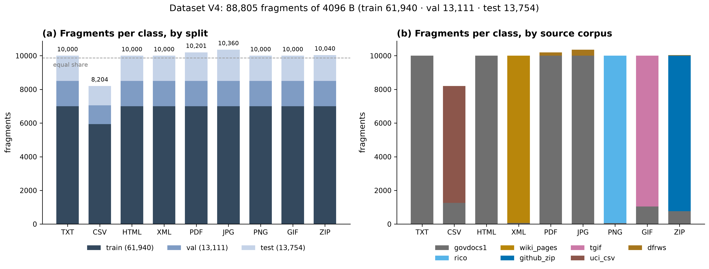
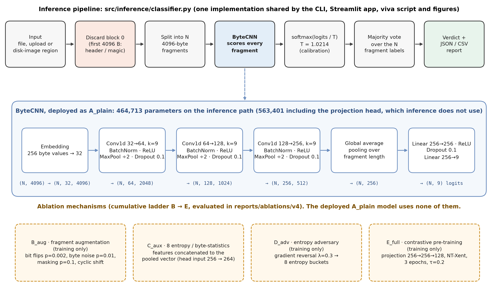
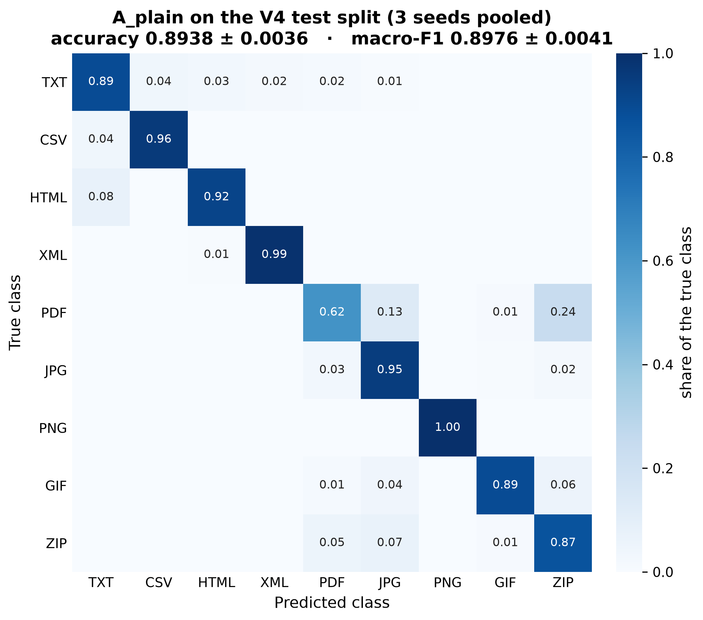
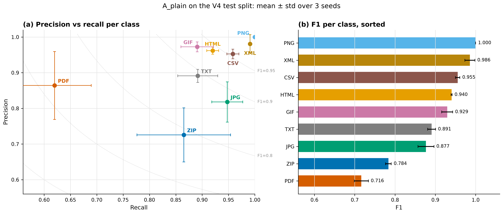
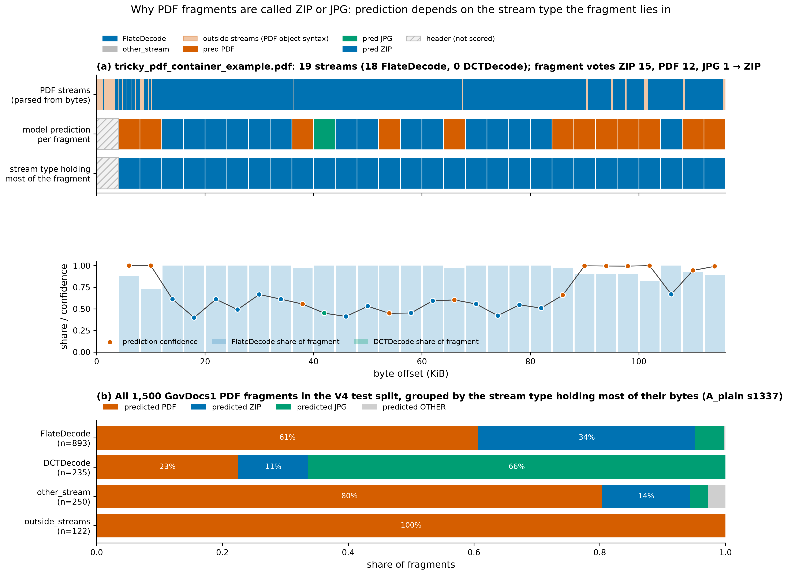

# FragGen V4 — Results and Discussion

**File-fragment type classification for digital forensics**

CSE4074 Forensics Analytics · final report · 2026-09-14

> **How to read the numbers.** Every value in this report is copied from an
> experiment output file named next to it. The report contains two families of
> results that must not be compared directly. **Dataset V4** measures generalisation
> to unseen *files* drawn from the training sources. The **cross-corpus study** (train
> FFT-75 → test GovDocs1) measures generalisation to an unseen *corpus*. Section 8
> explains why they differ.

---

## 1. Experimental Setup

**Task.** Given one 4096-byte block taken from the interior of a file, with no name,
no header and no filesystem metadata, predict its type from nine classes:
`txt, csv, html, xml, pdf, jpg, png, gif, zip`. A file-level verdict is the majority
vote over its blocks.

**Two experimental settings.**

| setting | train | "in" evaluation | "cross" evaluation | purpose |
|---|---|---|---|---|
| Dataset V4 (this report's main system) | `processed_v4/train.npz` | `val.npz`: held-out files | `test.npz`: held-out files | accuracy on unseen documents from the same real-world sources |
| Cross-corpus study (August) | FFT-75 | FFT-75 held-out | GovDocs1 | robustness to a change of corpus |

**Hardware and software.** One NVIDIA RTX 4050 Laptop GPU (6 GB), Python 3.11,
PyTorch 2.11 (CUDA 12.8), scikit-learn 1.9, SciPy 1.17.

**Metrics.** Accuracy, macro-F1, macro precision/recall, per-class precision/recall/F1,
confusion matrices, container-aware accuracy views, selective accuracy under an
abstain option, and expected calibration error (ECE). Multi-seed results are reported
as mean ± sample standard deviation.

**Reproducibility.** The whole pipeline, from raw bytes to dataset, training,
evaluation, analysis and figures, is scripted (Section 4 and the README). The
repository was reorganised before this report. The refactored `src` package was
verified against the pre-refactor code on CPU: logits bit-identical, evaluation output
identical, and a one-epoch training run with all mechanisms enabled gave bit-identical
weights.

---

## 2. Dataset Construction

Figure 1. Dataset V4 fragments per class by split (a) and by source corpus (b).
Source: <code>data/metadata/v4_fragment_metadata.csv</code>, cross-checked against the npz label arrays.

### 2.1 Why a new dataset was needed

Two earlier builds failed on class balance (`reports/datasets/DATA_AUDIT_2026-09-14.md`).
V3 was 49% PDF with only 0.2% PNG, because GovDocs1 alone is extremely unbalanced.
V2 over-weighted ZIP (32%). A classifier trained on either learns the class prior
as much as the format.

### 2.2 Sources

| class | main source(s) |
|---|---|
| txt, html, pdf, jpg | GovDocs1 (real U.S. government documents) |
| pdf, jpg, zip | plus DFRWS 2007 carving image, **test split only** |
| png | RICO mobile-UI screenshots |
| gif | TGIF animated GIFs (plus GovDocs1) |
| csv | real CSV files from public GitHub repositories (plus GovDocs1) |
| zip | real `.zip` archives from public GitHub repositories (plus GovDocs1) |
| xml | full Simple-English Wikipedia articles, one per file |

### 2.3 Construction rules (`scripts/build_processed_v4.py`)

1. **File-level split** 70/15/15 per class (seed 42), with an assertion that no file
   appears in two splits.
2. **Header exclusion:** fragments are sampled only at offsets ≥ 4096 from files of at
   least 8,192 B.
3. **Magic-leak filter:** a fragment beginning with its class's signature is dropped.
4. **Balance:** a per-class cap of 10,000 fragments across the splits, and at most 20
   fragments per source file so no single document dominates.
5. **Provenance:** every fragment's file id, offset and source is stored in the npz files
   and in `data/metadata/v4_fragment_metadata.csv`.

### 2.4 Result

| split | fragments |
|---|---:|
| train | 61,940 |
| val | 13,111 |
| test | 13,754 |
| **total** | **88,805** |

Per class: txt 10,000 · csv 8,204 · html 10,000 · xml 10,000 · pdf 10,201 · jpg 10,360 ·
png 10,000 · gif 10,000 · zip 10,040. Only CSV falls short of the cap, because its
sources ran out of files larger than 8 KB. PDF, JPG and ZIP slightly exceed it because
the DFRWS test fragments are added on top.

**Integrity audit** (`docs/REPOSITORY_AUDIT.md` §3). Hashing all raw files found **no
byte-identical source file shared between train and test**. One identical `.txt` pair
spans val and test (20 fragments, 0.15% of test). Validation data never influences
training or model selection (Section 4), so this pair cannot bias the test result.

---

## 3. Model Architecture

Figure 2. Inference pipeline and the ByteCNN classifier. Sizes and parameter
counts are read from <code>checkpoints/v4/A_plain_s1337.pt</code>.

| stage | layer | output |
|---|---|---|
| input | 4096 bytes (uint8) | (N, 4096) |
| embedding | 256 byte values → 32 dimensions | (N, 32, 4096) |
| 3 conv blocks | Conv1d (k = 9) → BatchNorm → ReLU → MaxPool ÷2 → Dropout 0.1; channels 64/128/256 | (N, 256, 512) |
| pooling | global average over length | (N, 256) |
| head | Linear 256→256 → ReLU → Dropout → Linear 256→9 | (N, 9) |

The inference path has **464,713 parameters**. The checkpoint also stores a 98,688-parameter
projection head, used only by contrastive pre-training. Temperature scaling
(T = 1.0214) is applied to the logits before the softmax and cannot change the argmax.

**Ablation mechanisms** (training-time switches, all settings from `configs/real.yaml`):

| rung | adds |
|---|---|
| A_plain | nothing: the plain CNN (the deployed model) |
| B_aug | fragment augmentation: bit flips p = 0.002, byte noise p = 0.01, masking p = 0.1, cyclic shift |
| C_aux | 8 entropy/byte-statistics features concatenated to the pooled vector |
| D_adv | entropy adversary: gradient-reversal head (λ = 0.3) predicting 8 entropy buckets |
| E_full | contrastive pre-training: NT-Xent (τ = 0.2) for 3 epochs, then fine-tuning |

---

## 4. Training Protocol

| setting | value |
|---|---|
| optimiser | Adam, learning rate 1e-3, weight decay 1e-4, batch 256 |
| epochs | 6, identical for every configuration |
| training data | all 61,940 training fragments (`--limit 0`; V4 is balanced at build time) |
| model selection | best epoch by accuracy on a 10% split carved from `train.npz` |
| seeds | 1337, 1338, 1339 (initialisation, internal split, data order, augmentation) |
| evaluation | `python -m src.training.eval` on `val.npz` and `test.npz` |
| driver | `python scripts/run_ablations.py` (its defaults are this protocol) |
| training time | A_plain: 9.8 min per seed on average (`driver_summary_A_plain.json`) |

`train.py` logs no per-epoch training-set accuracy, so no train-versus-validation curve
exists. Figure 5 in `reports/figures/` (`fig5_training_curves.png`) shows the
selection-split accuracy per epoch and the contrastive pre-training loss.

---

## 5. Results

### 5.1 Headline (A_plain, Dataset V4, 3 seeds)

| split | accuracy | macro-F1 | macro precision | macro recall |
|---|---|---|---|---|
| val | 0.9082 ± 0.0049 | 0.9087 ± 0.0053 | 0.9165 ± 0.0061 | 0.9095 ± 0.0048 |
| **test** | **0.8938 ± 0.0036** | **0.8976 ± 0.0041** | 0.9074 ± 0.0035 | 0.8982 ± 0.0035 |

Source: `reports/ablations/v4/ablation_summary.json`. Accuracy and macro-F1
recomputed from each run's confusion matrix match the reported values exactly
(max |Δ| = 0).

Figure 3. Row-normalised test confusion matrix, 3 seeds pooled.

### 5.2 Per class (test, mean over seeds)

| class | precision | recall | F1 |
|---|---:|---:|---:|
| png | 1.0000 | 1.0000 | 1.0000 |
| xml | 0.9809 | 0.9909 | 0.9857 |
| csv | 0.9525 | 0.9584 | 0.9553 |
| html | 0.9618 | 0.9200 | 0.9404 |
| gif | 0.9725 | 0.8907 | 0.9294 |
| txt | 0.8911 | 0.8916 | 0.8908 |
| jpg | 0.8180 | 0.9477 | 0.8767 |
| zip | 0.7255 | 0.8652 | 0.7836 |
| **pdf** | 0.8642 | **0.6198** | **0.7164** |

Source: `reports/tables/v4_per_class_metrics.csv`.

Figure 4. Per-class precision against recall (error bars: seed std) and per-class F1.

Six of nine classes reach F1 ≥ 0.89. The errors are concentrated in one structure:
**PDF recall is 0.62**, and the PDF fragments it loses reappear as low precision for
**ZIP (0.73)** and **JPG (0.82)**. In the pooled confusion matrix, 24% of PDF fragments are
predicted ZIP and 13% JPG. Section 9 shows this is a property of the PDF format.

### 5.3 Views that separate format ambiguity from error

| test accuracy view | value |
|---|---|
| strict (9 classes) | 0.8938 ± 0.0036 |
| html + xml merged | 0.8945 ± 0.0036 |
| coarse families (text · markup · document · image · archive) | 0.9065 ± 0.0043 |
| excluding true pdf/zip fragments | **0.9424 ± 0.0048** |
| keep the 90% most confident fragments (abstain on the rest) | 0.9342 ± 0.0032 |
| byte-histogram reference (byte frequencies only, no order) | 0.7715 |

Sources: the `taxonomy`, `reject` and `entropy_ceiling` fields of
`reports/ablations/v4/A_plain_s*.json`. Two conclusions follow. Removing the container
classes recovers most of the lost accuracy. And the CNN's +0.12 over the
byte-histogram reference is accuracy earned from byte *order*.

### 5.4 Confidence calibration

Temperature fitted on `val.npz`: **T = 1.0214**. Test-split ECE is 0.0217 before scaling
and 0.0219 after (`checkpoints/calibration/A_plain_s1337.calib.json`). The model is
already calibrated on V4-distributed data, so its confidence can be read as a probability
there.

---

## 6. Ablation Analysis

<!-- V4_ABLATION_RESULTS_START -->
### 6.1 Design

The cumulative ladder (Section 3) was trained on Dataset V4 with the protocol of
Section 4, identical for every rung: 6 epochs, seeds 1337–1339, 4096 B, all training
fragments. The repository's third rung is `C_aux` (entropy auxiliary features);
contrastive pre-training enters at `E_full`, so its marginal contribution is
E_full − D_adv.

Two statistical tests are used:

* **Seed-paired t-test** of each rung against A_plain (and of each rung against the
  previous one), with a 95% CI of the mean difference and Holm correction. Pairing by
  seed removes shared variation (same initialisation seed, internal split and data
  order), but with n = 3 there are only 2 degrees of freedom, so only large, consistent
  effects can be detected.
* **Exact McNemar test** on the 13,754 test fragments for each seed pair. It asks whether
  two specific trained models make different mistakes on the same data.

Results and all statistics are generated by `scripts/analyze_ablations.py` into
`reports/ablations/v4/ABLATION_RESULTS.md`. Every checkpoint's test predictions were
re-scored independently during analysis and matched the original evaluation report
exactly (15/15, max |Δ| = 0), and accuracy/macro-F1 recomputed from each confusion
matrix matched the reported values to within floating-point error.

### 6.2 Results

| config | mechanism added | test accuracy | test macro-F1 | Δ acc vs A_plain | Holm p | McNemar seeds significant | mean train time |
|---|---|---|---|---|---|---|---|
| A_plain | (none) | 0.8938 ± 0.0036 | 0.8976 ± 0.0041 | — | — | — | 9.8 min |
| B_aug | augmentation | 0.8958 ± 0.0032 | 0.8970 ± 0.0024 | +0.0019 | 1.000 | 2/3 | 10.3 min |
| C_aux | + entropy aux features | 0.8938 ± 0.0086 | 0.8965 ± 0.0092 | −0.0001 | 1.000 | 2/3 | 31.0 min\* |
| D_adv | + entropy adversary | 0.8603 ± 0.0152 | 0.8622 ± 0.0119 | **−0.0336** | 0.313 | **3/3** | 10.7 min |
| E_full | + contrastive pre-training | 0.8760 ± 0.0159 | 0.8769 ± 0.0155 | −0.0179 | 0.759 | 2/3 | 68.8 min |

Source: `reports/ablations/v4/ABLATION_RESULTS.md`. \*C_aux's mean training time is
inflated by one run that trained under GPU memory contention from another process
(55.7 min for that seed alone; see `RUN_PROVENANCE.md`) — an infrastructure artefact,
not a property of the mechanism.

**No mechanism improves test accuracy at a level distinguishable from seed-to-seed
variation** (all Holm-adjusted p > 0.3, n = 3 seeds, 2 degrees of freedom). The
largest apparent effect, D_adv's −0.034, does not survive Holm correction (p = 0.313),
though the *direction* is consistent everywhere D_adv is tested: it also produced the
one significant consecutive-rung comparison before correction (C_aux → D_adv:
Δ = −0.0335, p = 0.029, Holm p = 0.118) and the only mechanism whose McNemar test is
significant in all three seeds — and in 0 of those 3 seeds does it fix more fragments
than it breaks. Consistently making *different, and net worse*, mistakes across every
seed is the fingerprint of a real (if statistically unconfirmed at this sample size)
effect, not of noise. E_full shows the same direction more weakly, which is expected
since D_adv's mechanism is retained inside it.

This reproduces, on an unrelated dataset, the entropy-adversary's behaviour from the
August cross-corpus study (Section 6.3): a real cost to in-distribution accuracy from
training the backbone away from entropy-correlated cues, whether or not the class
label happens to be format type or corpus.

E_full is also by far the most expensive rung, at roughly 7× A_plain's training time,
for a result that is directionally worse. On Dataset V4, none of the four mechanisms
is worth its complexity or compute cost.
<!-- V4_ABLATION_RESULTS_END -->

### 6.3 The same question across corpora (August study, 12 seeds, 512 B)

| config | cross-corpus accuracy | Δ vs A_plain | p (Welch) | in-corpus Δ | p |
|---|---|---|---|---|---|
| A_plain | 0.5243 ± 0.0280 | — | — | — | — |
| B_aug | 0.5293 ± 0.0190 | +0.0051 | 0.610 | +0.0138 | 0.004 |
| C_aux | 0.5402 ± 0.0207 | +0.0159 | 0.130 | +0.0122 | 0.007 |
| D_adv | 0.5152 ± 0.0171 | −0.0091 | 0.348 | −0.0364 | < 0.001 |
| E_full | 0.5239 ± 0.0258 | −0.0003 | 0.975 | −0.0081 | 0.115 |

Source: `reports/ablations/cross_corpus_fft75_govdocs1/ablations_512_12seed/significance.txt`
(minimum detectable difference at n = 12 ≈ 0.019). No mechanism improved cross-corpus
accuracy. D_adv's apparently better gap came entirely from *lower* in-corpus accuracy.

---

## 7. Why Header Exclusion Matters

1. **It is the real forensic case.** Carving works on blocks from unallocated space.
   Only one block per file contains the header, and headers are often the first thing
   overwritten or separated. A classifier that needs the header solves the easy case,
   which signature tools already solve.
2. **Otherwise the model can cheat.** Block 0 carries magic numbers (`%PDF-`,
   `\x89PNG\r\n\x1a\n`, `PK\x03\x04`, `GIF89a`). A model that sees them reaches high
   accuracy by learning a few byte patterns, and that accuracy says nothing about
   mid-file blocks.
3. **It is enforced end to end.** The builder never samples offsets below 4096 and
   drops fragments that still begin with a signature. The audits scanned every stored
   fragment and found none. At inference, `FragGenClassifier` always discards block 0.
4. **A real inconsistency was found and fixed.** The earlier demo code skipped the header
   only for files larger than 8,192 B. A 5–8 KB file therefore had its *header* block
   classified, contradicting both the dataset rule and the documentation. The unified
   inference module always discards block 0, returns "no fragments" when nothing
   remains, and a unit test pins the behaviour.

Excluding the header makes every number in this report a statement about interior bytes,
which is what an examiner needs.

---

## 8. Why 89% Is Not Cross-Corpus

| evidence | Dataset V4 (held-out files) | cross-corpus (FFT-75 → GovDocs1) |
|---|---|---|
| "cross" accuracy | 0.8938 ± 0.0036 (3 seeds) | **0.6812 ± 0.0141** (4096 B, 2 seeds) |
| gap between in and cross | **0.0144 ± 0.0024** | 0.1647 ± 0.0247 (4096 B) · 0.2764 ± 0.0269 (512 B, 12 seeds) |
| ECE before calibration | 0.0217 | 0.1844 (`REVIEW1.md` §10) |
| ECE after in-corpus calibration | 0.0219 | 0.1393 (still overstated) |

Sources: `reports/ablations/v4/`, `reports/ablations/cross_corpus_fft75_govdocs1/`,
`checkpoints/calibration/`, `docs/thesis/REVIEW1.md` §10.

1. **The split, by construction.** V4's test files are new documents from the same
   corpora (GovDocs1, RICO, TGIF, GitHub, Wikipedia) that supplied the training files.
   The encoders, tool-chains, languages and templates are shared. The cross-corpus study
   tests on a corpus assembled independently of the training corpus.
2. **The gap.** A genuine change of corpus cost 16–28 accuracy points. V4's val→test
   difference is 1.4 points and is stable across seeds. That is what sampling different
   files from one distribution looks like.
3. **The calibration.** Under corpus shift the model's confidence is badly overstated
   even after calibration. On V4 it is correct without any correction, which is further
   evidence that there is no distribution shift.

**Therefore:** 0.894 answers *"how well does FragGen classify new documents from sources
it has learned?"* and 0.681 answers *"how well does it survive a different corpus?"*.
Both are valid and both are reported, but only the second is a cross-corpus result, and
it is **not** replaced by V4.

The cross-corpus study's conclusion stands: **fragment length and training-set size
govern cross-corpus accuracy.** Going from 512 to 4096 B added +0.128 (pooled over all
configurations, p = 0.00009; `blocksize_comparison.txt`). At 512 B, A_plain trained on
all 50k fragments per class reached 0.6325 ± 0.0205 cross-corpus (3 seeds,
`fulldata_512/summary.md`), against 0.5243 ± 0.0280 at 8k per class (12 seeds,
`ablations_512_12seed/summary.md`), a difference of +0.108. The three regularisation
mechanisms added nothing measurable cross-corpus (Section 6.3), and on Dataset V4 the
same mechanisms add nothing measurable in-corpus either (Section 6.2) — in the
adversary's case, directionally worse.

---

## 9. PDF/JPG/ZIP Ambiguity

Figure 5. (a) One PDF: parsed stream objects against per-fragment predictions.
(b) All 1,500 GovDocs1 PDF fragments in the V4 test split, grouped by the stream type
holding most of their bytes (A_plain seed 1337).

### 9.1 Mechanism

A PDF is a container. Its content streams, fonts and object streams are usually encoded
with **`/FlateDecode`**, which is zlib/DEFLATE, the algorithm inside ZIP archives.
Embedded photographs are usually **`/DCTDecode`**, which is a JPEG byte stream stored
verbatim. A 4096-byte window inside such a stream contains DEFLATE or JPEG data and
nothing specific to PDF.

### 9.2 Measurement

`src/explainability/container_analysis.py` parses `stream … endstream` objects and their
filters directly from a file's bytes. Every GovDocs1 PDF fragment in the V4 test split was
re-read from its source file (**1,500/1,500 byte-identical** to the stored fragment) and
assigned to the stream type holding most of its bytes:

| fragment lies mostly in | n | → PDF | → ZIP | → JPG | → other |
|---|---:|---:|---:|---:|---:|
| FlateDecode (DEFLATE) streams | 893 | 542 (60.7%) | 308 (34.5%) | 41 (4.6%) | 2 |
| DCTDecode (JPEG) streams | 235 | 53 (22.6%) | 26 (11.1%) | **156 (66.4%)** | 0 |
| other streams | 250 | 201 (80.4%) | 35 (14.0%) | 7 (2.8%) | 7 |
| outside streams (PDF object syntax) | 122 | **122 (100%)** | 0 | 0 | 0 |

Source: `reports/tables/v4_test_pdf_fragments_by_stream_region.json`.

* **Every** fragment made of PDF object syntax is recognised as PDF.
* JPG predictions come predominantly from JPEG streams: 156 of the 204 JPG calls.
* ZIP predictions come predominantly from DEFLATE streams: 308 of the 369 ZIP calls.

### 9.3 A single file, fragment by fragment

`demo/samples/tricky_pdf_container_example.pdf` has 28 scored fragments over 19 streams
(18 FlateDecode). Its vote is ZIP 15, PDF 12, JPG 1, so the **file-level verdict is wrong**.
Fragment by fragment, the picture is precise:

* all 15 ZIP fragments lie entirely inside FlateDecode data (0% object syntax);
* every fragment containing at least 8% PDF object syntax was called PDF with ≥ 94% confidence.

The fragment-level predictions follow the bytes each fragment contains. The file-level
majority vote is what fails, because this particular PDF is mostly compressed payload.

### 9.4 Consequences

* PDF's recall of 0.62 mostly measures the gap between the **extension label** ("this
  came from a .pdf") and the **byte content** ("this is DEFLATE data"). The same
  structure appeared independently in the cross-corpus study (`FINDINGS.md` §5.4).
* The error is **not entirely irreducible**. Even inside FlateDecode-dominated fragments,
  61% are still recognised as PDF, so PDF-specific cues near stream boundaries can be
  learned further.
* For casework, a PDF fragment called ZIP should be reported as *"compressed data,
  consistent with a PDF stream or a ZIP archive"*. The tool's notes and stream map
  support exactly that wording.

A similar but smaller effect exists for markup. HTML and XML share syntax, and the
declaration that separates them sits in the excluded header. Merging the two classes
changes test accuracy by only 0.0007 on average, so it is a minor source of error here
(one bundled XML sample is nevertheless read entirely as HTML).

---

## 10. Limitations

1. **V4 is not a cross-corpus benchmark** (Section 8). The only cross-corpus evidence is
   the FFT-75 → GovDocs1 study, which was built on the earlier data pipeline and a
   different class balance.
2. **Labels come from file extensions.** Container formats are therefore scored as errors
   when the bytes are ambiguous (Section 9). There is also a small amount of genuine label
   noise, such as one byte-identical HTML/TXT pair in train.
3. **Limited type coverage.** There are nine classes, and no Office documents,
   executables, audio/video or encrypted data. The hardest high-entropy confusions,
   encrypted versus compressed data, are untested.
4. **Statistical power.** Three seeds give paired tests with 2 degrees of freedom, so
   small effects cannot be resolved; a non-significant result means "not detected".
5. **Independent fragments.** Blocks are classified in isolation, although carvers
   usually see contiguous runs. An exploratory contiguous-run aggregation during the
   cross-corpus study suggested a gain, but its raw output was not saved (only the
   archived status log records it), so no figure is quoted here.
6. **Uneven sources.** Some classes come mostly from one corpus (PNG from RICO, XML from
   Wikipedia), so near-perfect scores on them partly reflect that corpus's uniformity.
7. **Compute.** One laptop GPU with 6 GB; timings are indicative only.

---

## 11. Future Work

* **Container-aware labelling:** hierarchical targets (container → payload), or labels
  derived from the parsed stream type, so a DEFLATE block inside a PDF is not an error.
* **Context across blocks:** a lightweight sequence model over the embeddings of adjacent
  blocks, matching how carvers encounter data.
* **A balanced cross-corpus V4:** hold out whole sources (for example, a second screenshot
  corpus for PNG) to measure corpus shift without the class imbalance of the earlier study.
* **Calibration under shift:** per-source temperatures or conformal prediction sets with
  coverage that holds on unseen corpora.
* **More classes and negatives:** Office formats, executables, media, and encrypted/random
  data.
* **More seeds** for the ablation ladder, so effects smaller than a point can be resolved.

---

## 12. Conclusion

FragGen V4 classifies 4096-byte interior fragments into nine types with **0.894 ± 0.004
test accuracy and 0.898 macro-F1** on unseen documents from its training sources. It
uses a 465k-parameter byte CNN that never sees a file header, produces calibrated
confidence on this data, and returns an explainable per-fragment trace.

The engineering contribution is a reproducible system: a balanced, audited dataset with
per-fragment provenance; one inference implementation shared by the CLI, web app, viva
script and figures; and reports whose numbers trace back to result files.

The scientific contribution is an honest account of what the numbers mean. The 0.894 is
not a cross-corpus result: across corpora the same architecture reaches **0.681** at
4096 B, and that gap is governed by fragment length and data volume rather than by
regularisation mechanisms. The model's dominant error, PDF read as ZIP or JPG, was
measured rather than asserted. The predictions follow the stream type each fragment lies
in, and every fragment of PDF object syntax is recognised correctly. The remaining
challenge is therefore mostly one of labelling and context, not of recognising bytes.
