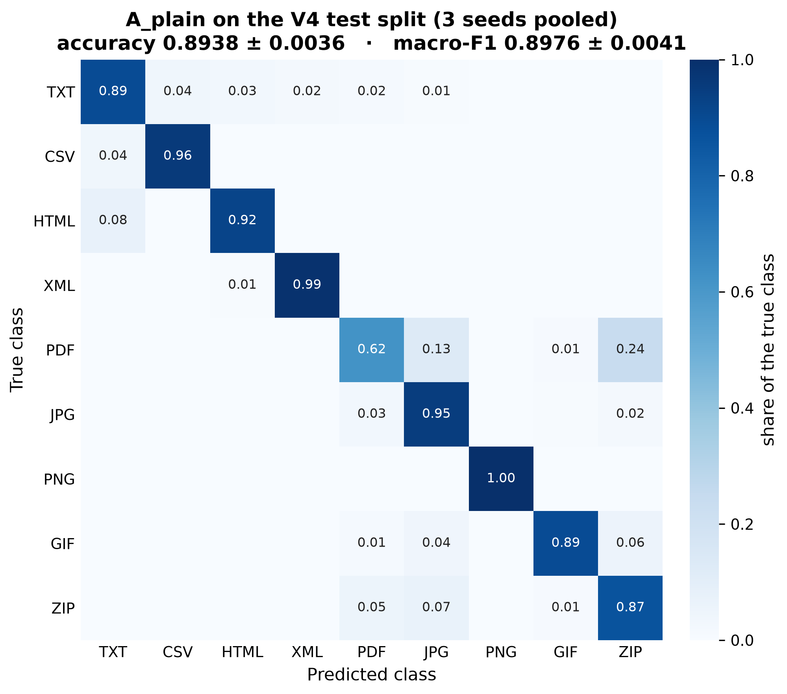
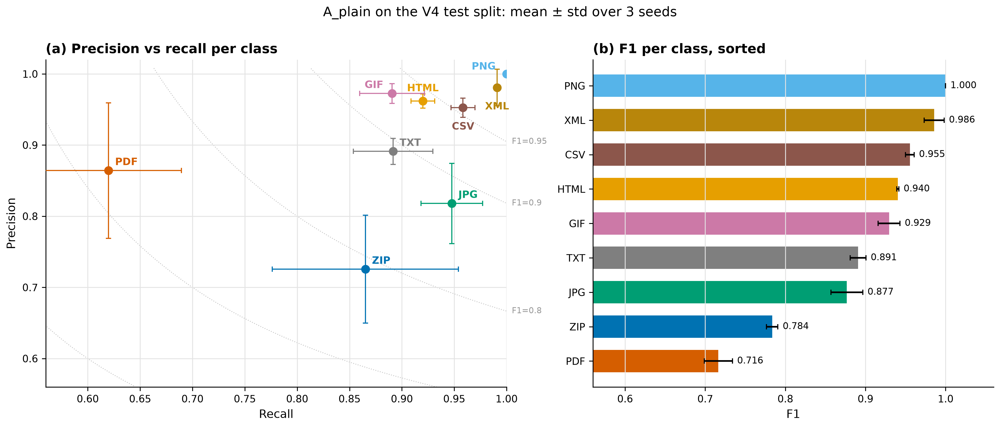
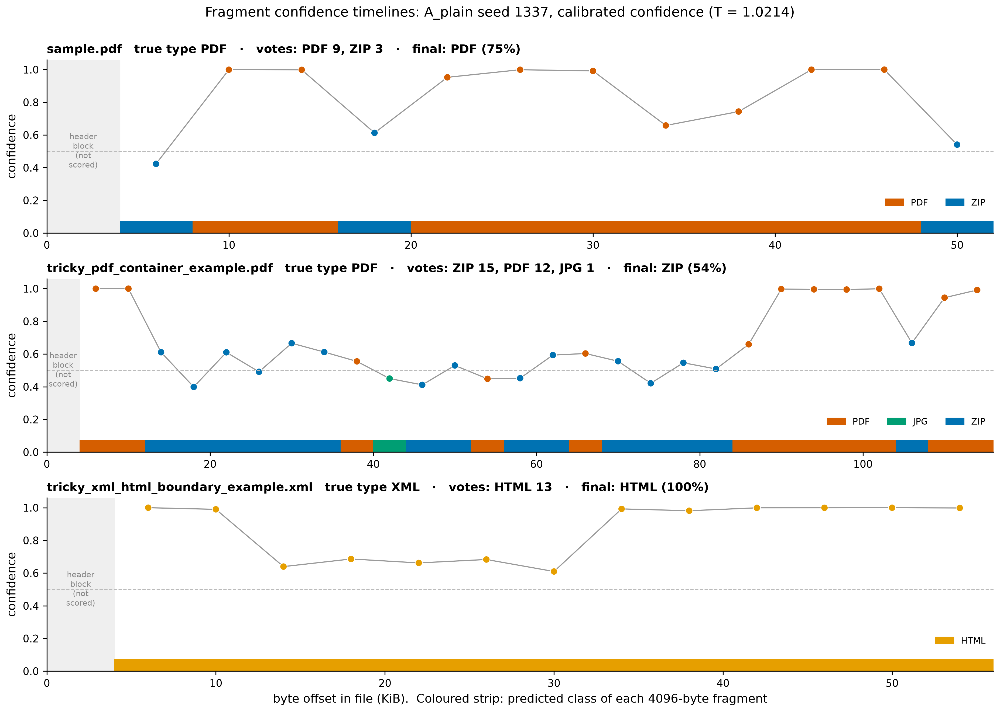
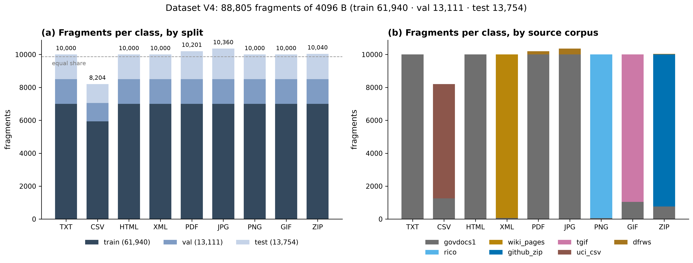
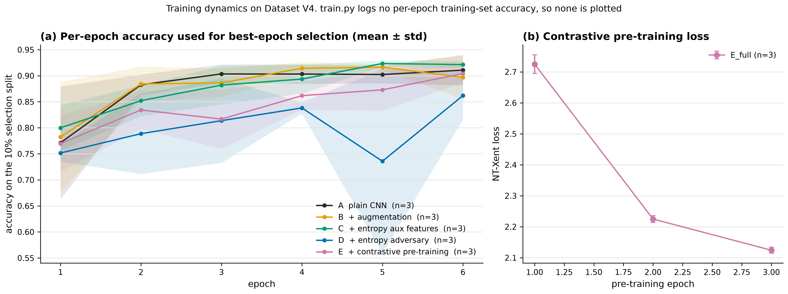
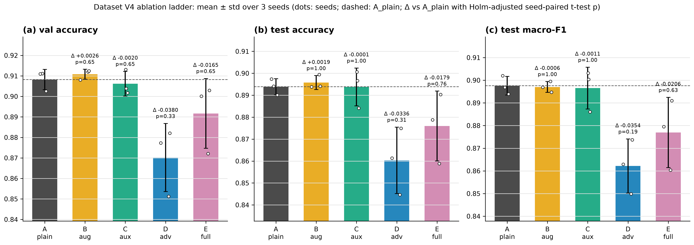
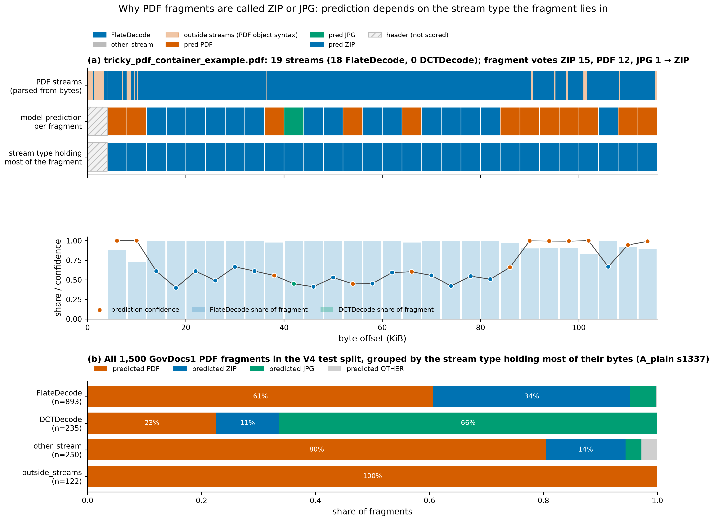
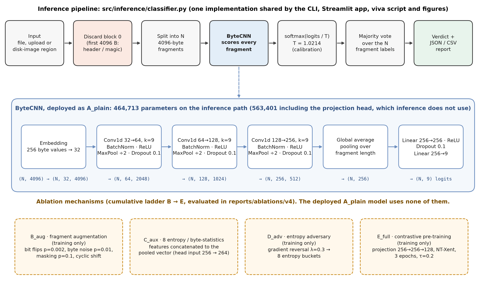

# Figures

Generated by `scripts/make_publication_figures.py` (matplotlib only, 300 dpi PNG; the architecture diagram is also SVG). Cross-corpus figures from the August study are in `cross_corpus/`.

## fig1_confusion_matrix

Row-normalised confusion matrix of the plain byte-CNN on the Dataset V4 test split, summed over 3 training seeds (41,262 fragment evaluations). Most off-diagonal mass is PDF fragments predicted as ZIP or JPG.

Data: `reports/ablations/v4/A_plain_s1337.json`, `reports/ablations/v4/A_plain_s1338.json`, `reports/ablations/v4/A_plain_s1339.json`

## fig2_precision_recall

Per-class precision against recall (error bars: seed std) with iso-F1 contours, and per-class F1. PDF has high precision but the lowest recall; ZIP and JPG lose precision to the PDF fragments they absorb.

Data: `reports/ablations/v4/A_plain_s1337.json`, `reports/ablations/v4/A_plain_s1338.json`, `reports/ablations/v4/A_plain_s1339.json`

## fig3_fragment_confidence_timeline

Per-fragment calibrated confidence across three files. A mostly-correct PDF with three low-confidence ZIP fragments; a PDF whose majority vote flips to ZIP; and an XML file read as HTML.

Data: `checkpoints/v4/A_plain_s1337.pt`, `checkpoints/calibration/A_plain_s1337.calib.json`, `demo/samples/sample.pdf`, `demo/samples/tricky_pdf_container_example.pdf`, `demo/samples/tricky_xml_html_boundary_example.xml`

## fig4_dataset_class_distribution

Dataset V4 class balance. The per-class cap keeps every class near an equal share; CSV falls short because its sources ran out of usable files. Panel (b) shows which real corpus supplied each class.

Data: `data/metadata/v4_fragment_metadata.csv`, `data/processed_v4/{train,val,test}.npz (label arrays, cross-checked)`

## fig5_training_curves

Accuracy after each epoch on the 10% split carved from train.npz, which train.py uses to keep the best epoch (band: seed std); and the NT-Xent loss during E_full's contrastive pre-training. train.py records no per-epoch training-set accuracy, so no train-vs-validation curve is shown.

Data: `reports/ablations/v4/logs/*.train.log`

## fig6_ablation_comparison

Validation and test accuracy and test macro-F1 for the cumulative ablation ladder on Dataset V4. Annotations give the seed-paired difference from A_plain and its Holm-adjusted p-value.

Data: `reports/ablations/v4/A_plain_s*.json`, `reports/ablations/v4/B_aug_s*.json`, `reports/ablations/v4/C_aux_s*.json`, `reports/ablations/v4/D_adv_s*.json`, `reports/ablations/v4/E_full_s*.json`, `reports/ablations/v4/ablation_summary.json`

## fig7_pdf_container_analysis

PDF container analysis. (a) For one PDF, stream objects parsed from its bytes against the per-fragment predictions. (b) Every GovDocs1 PDF fragment in the V4 test split, each byte-verified against its source file and grouped by the stream type holding most of its bytes: ZIP predictions concentrate in FlateDecode data and JPG predictions in DCTDecode data.

Data: `demo/samples/tricky_pdf_container_example.pdf`, `data/processed_v4/test.npz`, `data/raw/govdocs1_files/`, `checkpoints/v4/A_plain_s1337.pt`, `reports/tables/v4_test_pdf_fragments_by_stream_region.{csv,json}`

## fig8_pipeline_architecture

FragGen inference pipeline and ByteCNN architecture. Layer sizes, parameter counts, the calibration temperature and the ablation hyper-parameters are read from the checkpoint, the calibration file and configs/real.yaml, not typed by hand.

Data: `checkpoints/v4/A_plain_s1337.pt`, `checkpoints/calibration/A_plain_s1337.calib.json`, `configs/real.yaml`, `src/models/cnn.py`
